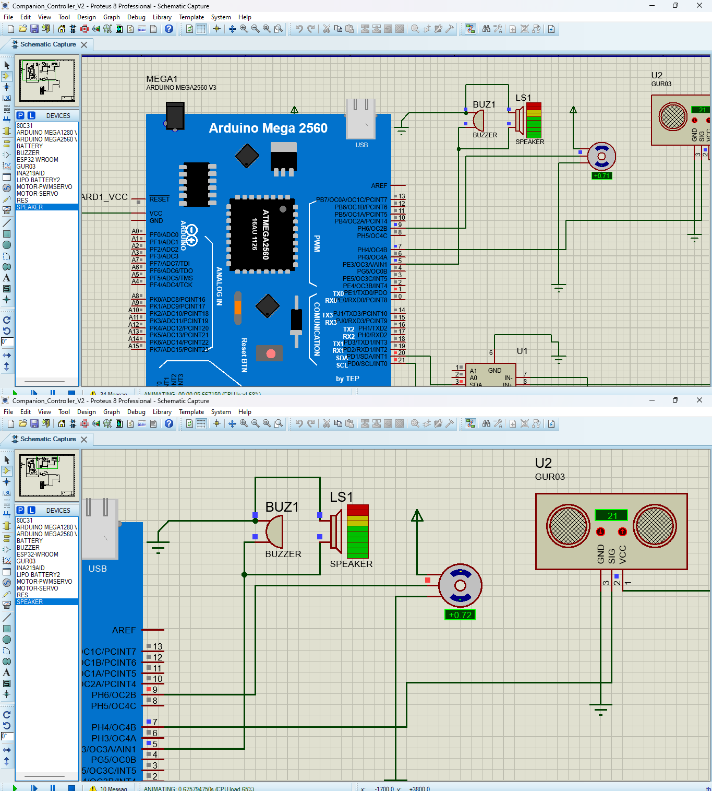
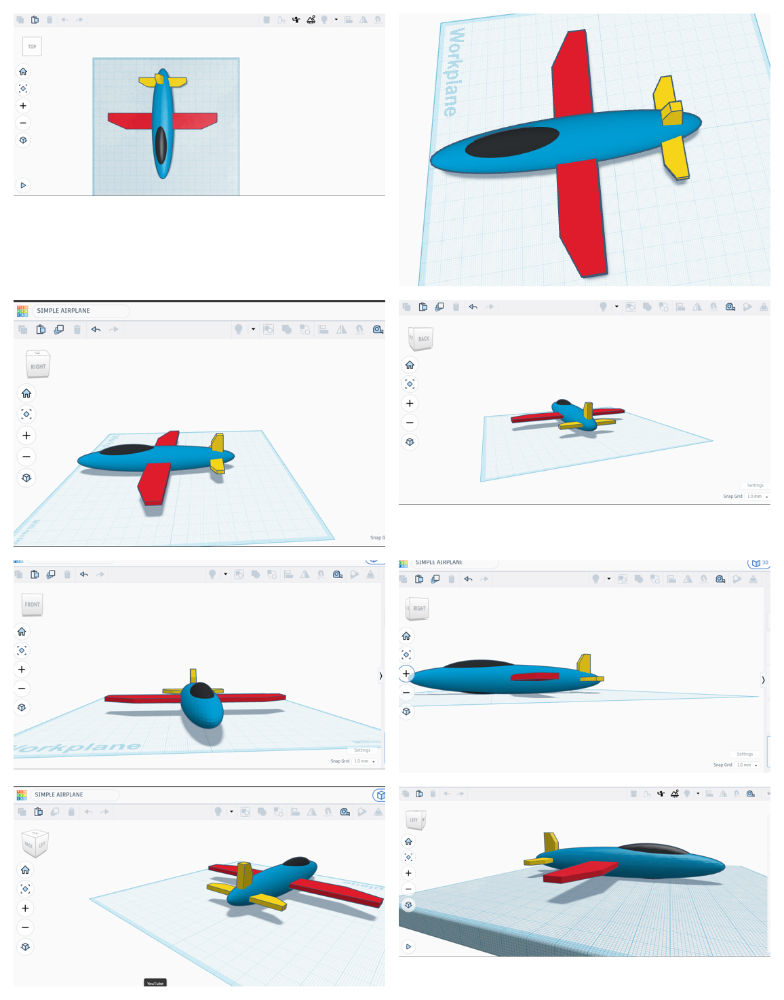
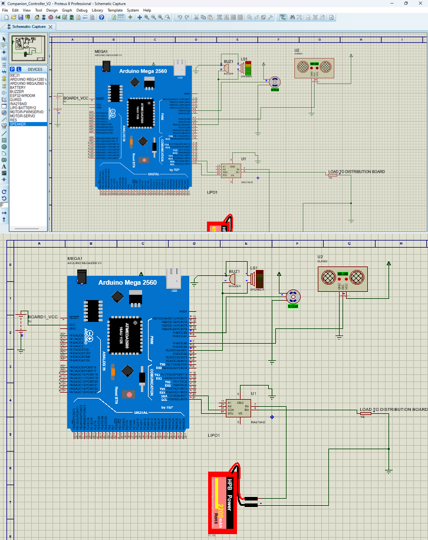

# Drone Companion Controller 🚁

An Arduino Mega 2560-based drone companion controller firmware and simulation project developed during my internship at.

This system integrates power monitoring, distance sensing, I2C communication, an audible proximity alarm, and servo payload control to serve as an intelligent onboard companion subsystem.



---

## 🛠️ Features & Hardware Integration

- **Microcontroller:** Arduino Mega 2560 (chosen for its ample I/O pins and hardware serial ports).
- **Power Monitoring:** INA219 sensor for real-time current measurement over I2C, streamed to the serial monitor.
- **Proximity Sensing:** Ultrasonic distance sensor on a single shared signal pin (trigger and echo on the same line).
- **Proximity Alarm:** Buzzer plays a two-tone siren when an obstacle is within 20 cm.
- **Actuation:** Servo motor releases the payload when measured current exceeds 100 mA.
- **Modelling & Simulation:** Basic airframe modelled in 3D from multiple perspectives; control circuit tested in Proteus ISIS.

---

## 📂 Repository Structure

```text
├── firmware/
│   └── drone_companion_controller.ino   # Main Arduino C++ source code
├── schematics/
│   └── proteus_simulation.pdsprj        # Proteus ISIS circuit design file
├── docs/
│   ├── LET_combined.png                 # Internship / project photos
│   ├── modelling_images/
│   │   └── tinkerCard_images.png        # Airframe model, plan and perspective views
│   └── wiring/
│       └── wiring_combined.png          # Wiring and pinout reference
└── README.md
```

---

## ✈️ Airframe Modelling

A basic plane airframe was modelled in 3D to define where the companion controller, sensors and payload release mechanism would sit. The image below shows the plan view and the model from several different perspectives.



---

## 🔌 Pinout & Wiring Guide



| Component                 | Arduino Mega 2560 Pin | Description                          |
|---------------------------|-----------------------|--------------------------------------|
| INA219 (SDA)              | Pin 20 (SDA)          | I2C Data Line                        |
| INA219 (SCL)              | Pin 21 (SCL)          | I2C Clock Line                       |
| Ultrasonic Sensor (SIG)   | Pin 7                 | Shared trigger/echo signal           |
| Buzzer                    | Pin 5                 | Proximity siren output               |
| Servo Motor (Signal)      | Pin 9 (PWM)           | Payload release actuation            |

---

## ⚙️ How It Works

Each loop iteration (about every 500 ms plus siren time):

1. Pulses the ultrasonic sensor and converts the echo time to distance in cm.
2. Reads current from the INA219 and prints it over serial (9600 baud).
3. If distance is **20 cm or less**, plays a 1000 Hz / 2000 Hz siren on the buzzer.
4. If current exceeds **100 mA**, moves the servo to 90° to release the payload.

---

## 🚀 Getting Started

### Prerequisites

- Arduino IDE (v1.8.x or v2.x)
- Proteus Professional (for running the circuit simulation)
- Required libraries:
  - `Adafruit_INA219` (install via Arduino Library Manager)
  - `Servo` (built-in Arduino library)

### Running the Simulation

1. Clone this repository or download the ZIP:

```bash
   git clone https://github.com/alfredoeinsteino2024/drone-companion-controller.git
```

2. Open `schematics/proteus_simulation.pdsprj` in Proteus ISIS.
3. Compile the `.ino` sketch in the Arduino IDE (or export the compiled `.hex` file) and load it into the Arduino Mega model within Proteus.
4. Run the simulation to observe real-time current readings, the buzzer siren, and servo actuation.

---

## 💡 Engineering Takeaways

Working on this project pushed me to bridge the gap between firmware logic and hardware simulation. Debugging the I2C communication with the INA219 alongside the timing of the ultrasonic trigger/echo sequence was a great exercise in robust embedded systems design.

---

## 📜 License

This project is open-source and available under the [MIT License](LICENSE).
